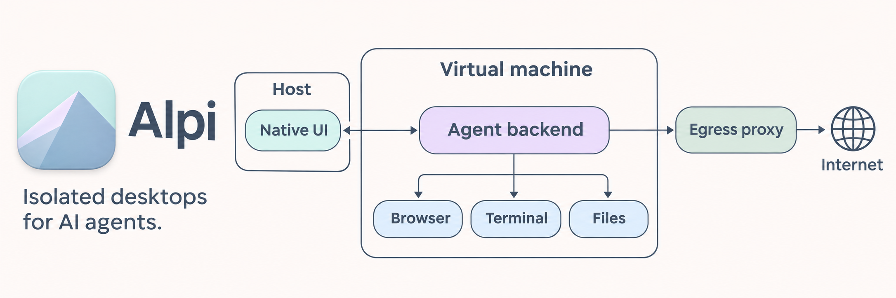
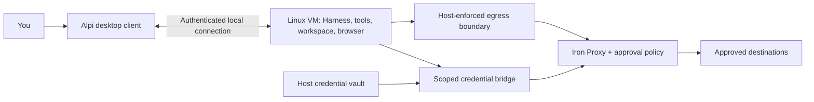

<p align="center">
  
</p>

<h1 align="center">Alpi — isolated workspaces for AI agents</h1>

<p align="center">
  Give your coding agent a computer of its own.<br>
  Keep its workspace in a VM, approve its network access, and keep managed credentials on your host.
</p>

<p align="center">
  <a href="https://github.com/Alexintosh/alpi-isolated-agent/releases"></a>
  <a href="LICENSE"></a>
  <a href="docs/setup.md"></a>
</p>

<p align="center">
  <a href="#why-alpi">Why Alpi</a> ·
  <a href="#how-it-works">How it works</a> ·
  <a href="#run-on-macos">macOS</a> ·
  <a href="#run-on-linux">Linux</a> ·
  <a href="SECURITY.md">Security model</a> ·
  <a href="AGENTS.md">Agent setup</a>
</p>

> **Developer preview.** [Download Alpi for macOS Apple Silicon](https://github.com/Alexintosh/alpi-isolated-agent/releases/download/v0.1.0-alpha.2/Alpi-0.1.0-alpha.2-macOS-arm64.dmg) · [Release notes and checksums](https://github.com/Alexintosh/alpi-isolated-agent/releases/tag/v0.1.0-alpha.2). The DMG installs the client; **the VM runtime package is separate and is not distributed yet**. A fresh Mac cannot start a guest from the DMG alone. The app is ad-hoc signed, not notarized. Linux host support and full release acceptance remain unfinished. See [setup and release limits](docs/setup.md).

## Why Alpi

A coding agent can install packages, run shell commands, browse the web and rewrite a project. Those are useful capabilities. They also give a mistaken instruction, a malicious dependency or a compromised model somewhere to act.

When that somewhere is your everyday computer, an experiment can reach beyond its intended workspace. Alpi gives the agent a separate Linux environment and makes the crossings visible: **which files go in, which results come out, and which network destinations it can reach.**

Use it to evaluate unfamiliar models, work on disposable copies of repositories, or run browser-assisted coding tasks without granting the agent your entire home directory. Keep the original DeepSeek Harness interface, with its sessions, streaming responses, tools and terminal, while the backend and its work run inside a VM.

Alpi is an open-source AI agent sandbox built around an explicit trust boundary. It does not need the model to recognize a dangerous instruction before the host can restrict its capabilities. It also does not make model output trustworthy: review generated code and exported files before using them.

## What you control

| Capability | What it gives you |
| --- | --- |
| **VM-backed workspaces** | Persistent Linux environments through Lima or WrapVM on smolvm. The agent loop, tools and working files live in the guest. |
| **Network approvals** | Iron Proxy on the host, with Allow once / Always and Deny once / Always. Identify imported inference endpoints and manage rules from one panel. |
| **Host-held credentials** | App-managed model keys and Git HTTPS credentials stay in the host vault. Scoped requests use a host credential bridge. |
| **Explicit file access** | Import and export files, or deliberately share a specific host folder read-only or read-write. No home-directory share by default. |
| **Browser and desktop** | View the WrapVM desktop and focus its browser from the app. Lima is the workspace/terminal option. |
| **Recoverable environments** | Disconnect while work continues, restart without erasing data, or explicitly recreate the selected VM. |

**Allow all** relaxes destination approvals; it does not bypass the proxy. **Block all** blocks guest application egress. These controls apply to Alpi's managed guests, not to your host's other apps.

## How it works



The native client displays the original Harness UI served by the guest. Local settings and approvals stay separate from guest content. Alpi adapts existing transports and stock VM engines; it does not fork Harness core or replace your normal Harness installation.

The security goal treats **root inside the guest as untrusted**. Enforcement belongs outside that guest. This is a design goal backed by bounded tests on the development Mac, not a claim of complete containment on every system. Read the [security model and limitations](SECURITY.md) before choosing what to expose.

## Run on macOS

**Current target: Apple Silicon.** The client uses macOS virtualization and Keychain facilities. The downloadable client and local builds are ad-hoc signed, not notarized; Intel Macs have not been validated.

1. Read the [prerelease notes](https://github.com/Alexintosh/alpi-isolated-agent/releases).
2. [Download the DMG](https://github.com/Alexintosh/alpi-isolated-agent/releases/download/v0.1.0-alpha.2/Alpi-0.1.0-alpha.2-macOS-arm64.dmg), open it and drag **Alpi.app** to **Applications**. A verified runtime package is required to start guests; this prerelease does not distribute that package. See [installation instructions](docs/macos-distribution.md), including first launch and safe updates.
3. With a compatible runtime package available, open **Settings → Install runtime package**, select it, then choose an environment and **Connect**.
4. Configure model access in **Models**, then review network requests as they arrive. Source builds support manual OpenAI-compatible providers or optional DSH import, with GitHub repository credentials managed in **Secrets**.

For development, build the client from source:

```sh
git clone https://github.com/Alexintosh/alpi-isolated-agent.git
cd alpi-isolated-agent
npm ci
npm run package:mac
open dist/Alpi.app
```

This builds the client, not its VM payload. See [macOS setup](docs/setup.md#macos-client) for prerequisites, runtime preparation constraints, model authorization and troubleshooting.

## Run on Linux

**Linux hosts cannot run the protected Alpi runtime yet.** Linux is the guest OS today. The host drivers, network confinement and credential vault currently depend on macOS; Electron's Linux support alone does not make this application portable.

You can install the source dependencies and run the platform-independent development checks on Linux:

```sh
git clone https://github.com/Alexintosh/alpi-isolated-agent.git
cd alpi-isolated-agent
npm ci --ignore-scripts
npm run test:portable
```

Those checks use synthetic fixtures. They do not start a VM or establish Linux isolation. The [Linux porting checklist](docs/setup.md#linux-development) describes what a supported host implementation still needs. Remote/cloud engines are a future extension, not part of this prerelease.

## A normal working session

Connect to your environment, import a working copy of your project, and work in Harness. Approve the destinations the task needs. Export the result when you are ready to review it on the host.

Closing the window leaves the environment running with a menu-bar indicator. **Disconnect** detaches the client; **Stop VM** stops jobs. **Quit** stops managed environments before exiting. **Recreate environment** requires confirmation and erases guest data while preserving host files and app-managed credentials. See [environment management](docs/environment-management.md).

## For developers and coding agents

Start with [AGENTS.md](AGENTS.md) and the [setup guide](docs/setup.md). They cover the repository map, safe test commands, runtime manifests and the boundaries that changes must preserve. No model key is needed for unit tests.

Source builds also provide an opt-in [Alpi MCP integration](docs/alpi-orchestration.md)
and [delegation skill](skills/alpi/SKILL.md). A trusted host coding agent can assign
work inside the VM, verify it with guest commands and export results for review.
Enable the broker explicitly; guest agents receive no host tool access.

Security bugs belong in a [private vulnerability report](https://github.com/Alexintosh/alpi-isolated-agent/security/advisories/new), not a public issue containing credentials or private logs. Other reproducible bugs and proposals are welcome in [Issues](https://github.com/Alexintosh/alpi-isolated-agent/issues).

## License and acknowledgments

Alpi's original application code is [MIT licensed](LICENSE). Dependencies, guest images and third-party assets retain their own licenses; see [third-party notices](THIRD_PARTY_NOTICES.md). Alpi is an independent project, not an official DeepSeek product.

Built with, and grateful to:

- [DeepSeek Harness](https://github.com/deepseek-ai/deepseek-harness) — the agent runtime and original interface.
- [Lima](https://github.com/lima-vm/lima), [smolvm](https://github.com/smol-machines/smolvm) and [libkrun](https://github.com/containers/libkrun) — virtual machine infrastructure.
- [WrapVM](https://github.com/tobi/wrapvm), [voxl](https://github.com/tembo/voxl) and [agent-browser](https://github.com/vercel-labs/agent-browser) — guest desktop, viewer and browser tooling.
- [Iron Proxy](https://github.com/paradigmxyz/iron-proxy) — host-side network mediation.
- [Electron](https://github.com/electron/electron), [Chromium](https://www.chromium.org/), [Node.js](https://nodejs.org/), [Python](https://www.python.org/) and [python-build-standalone](https://github.com/astral-sh/python-build-standalone) — application and runtime foundations.
- [Ubuntu](https://ubuntu.com/), [Linux](https://kernel.org/) and [XFCE](https://www.xfce.org/) — the guest operating system and desktop.
- [gRPC](https://github.com/grpc/grpc-node), [protobuf.js](https://github.com/protobufjs/protobuf.js), [js-yaml](https://github.com/nodeca/js-yaml) and [Undici](https://github.com/nodejs/undici) — host protocol and configuration libraries. The production dependency inventory is included in the notices.

Research informing the threat model is linked and discussed in [SECURITY.md](SECURITY.md#research-context).
